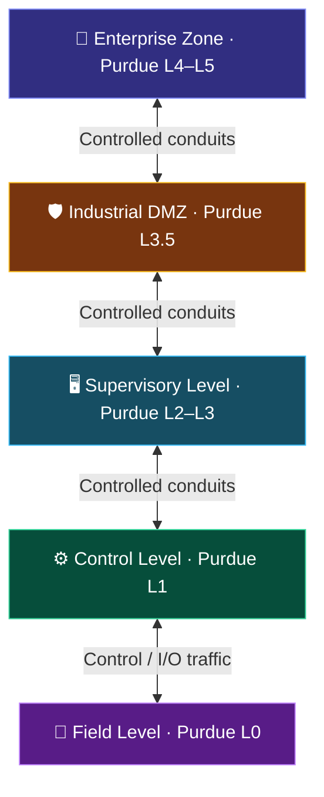

<div align="center">


# SCADAShield Network Planner

### Design, segment, and screen industrial networks — visually.

[](https://esp046-cyber.github.io/SCADAShield-Network-Planner/)
[](https://react.dev/)
[](https://vitejs.dev/)
[](https://web.dev/progressive-web-apps/)

**A browser-based SCADA/OT network design studio with Purdue Model swimlanes, interactive topology editing, automated security screening, and downloadable reports.**

</div>

---

## 🛡️ Overview

SCADAShield Network Planner helps SCADA engineers, OT architects, and security practitioners sketch industrial network architectures and identify potential segmentation and communication-security issues.

Build a topology by placing equipment into Purdue Model zones, connecting devices with protocol-aware conduits, and reviewing the live findings panel. Export the resulting assessment as a PDF or structured JSON report.

> **Project status:** Version `1.0.0`  
> **Live application:** [esp046-cyber.github.io/SCADAShield-Network-Planner](https://esp046-cyber.github.io/SCADAShield-Network-Planner/)

## ✨ Key features

| Feature | Description |
|---|---|
| 🗺️ Visual network canvas | Drag, position, connect, and organize industrial assets on an interactive topology canvas. |
| 🏭 Purdue Model zones | Five swimlanes represent Enterprise, Industrial DMZ, Supervisory, Control, and Field levels. |
| 🧰 Equipment palette | Add firewalls, VPN gateways, managed switches, servers, HMIs, PLCs, remote I/O, and business hosts. |
| 🔌 Protocol-aware conduits | Configure connections using common industrial and IT protocols, with protocol ports and encryption metadata. |
| 🔎 Live security screening | Analyze the topology for selected zone, conduit, exposure, encryption, and segmentation concerns. |
| 📊 Security posture score | View a calculated score, verdict, and counts of errors, warnings, and informational findings. |
| 📄 PDF and JSON reports | Export a human-readable PDF assessment or structured JSON report. |
| 💾 Local autosave | Project topology and project name are saved in the browser's local storage. |
| 📴 Offline-capable PWA | After the application has been loaded and cached, the planner can be used offline. |
| 📱 Responsive interface | Dark industrial-themed interface with responsive controls. |

## 🧭 Purdue Model zones

The canvas is organized into five network zones. A device's zone is determined by its position in the corresponding swimlane.



| Zone | Purdue level | Typical role |
|---|---:|---|
| Enterprise Zone | L4–L5 | Business workstations and enterprise IT |
| Industrial DMZ | L3.5 | Controlled exchange and remote-access boundary |
| Supervisory Level | L2–L3 | SCADA servers, supervisory systems, and HMIs |
| Control Level | L1 | PLCs, controllers, and control network equipment |
| Field Level | L0 | Remote I/O and field instrumentation |

## 🧰 Equipment catalogue

The current equipment palette includes:

- **Network & Security:** Industrial Firewall, VPN Gateway, Managed Switch
- **Supervisory & HMI:** Wonderware System Platform, GE iFIX Node
- **Controllers:** Siemens PLC, Allen-Bradley Controller
- **Other:** Remote I/O / RTU, Business LAN Host

Equipment entries include default labels, vendor metadata, visual categories, and permitted Purdue zones.

## 🔐 Protocol catalogue

Connections can be configured with protocols represented in the application's catalogue:

| Protocol | Default port | Native encryption in planner |
|---|---:|---|
| OPC UA (Sign & Encrypt) | `4840` | Yes |
| CIP Security | `2221` | Yes |
| S7CommPlus + TLS | `102` | Yes |
| MQTT over TLS | `8883` | Yes |
| HTTPS | `443` | Yes |
| SSH | `22` | Yes |
| IPsec VPN Tunnel | `500/4500` | Yes |
| Modbus TCP | `502` | No |
| DNP3 | `20000` | No |
| EtherNet/IP (CIP) | `44818` | No |
| S7comm (classic) | `102` | No |
| Wonderware SuiteLink | `5413` | No |
| SQL Server (TDS) | `1433` | No |
| OPC Classic (DCOM) | `135 + dynamic` | No |
| SMB / File Share | `445` | No |
| RDP | `3389` | Marked as risky; encryption metadata is enabled |

A conduit can also be marked as using a VPN tunnel. The screening logic considers native protocol encryption and the VPN tunnel flag when evaluating effective encryption.

## 🧪 Security checks

The current rule set screens topology-related concerns such as:

- PLCs connected directly to the Business LAN
- Critical control assets placed in the Enterprise zone
- Conduits that skip Purdue zones
- Zone boundaries crossed without a firewall or security gateway
- Unencrypted traffic crossing the DMZ without a VPN tunnel
- Cleartext protocols crossing zone boundaries
- Risky protocols such as RDP, SMB, and OPC Classic/DCOM crossing zones
- Enterprise-to-operations paths that bypass the DMZ
- Switches bridging multiple security zones
- Firewalls with fewer than two connections
- Assets placed outside their expected Purdue zones
- Missing Industrial DMZ or firewall components
- Devices outside all defined zones or with no connections

Findings are grouped by severity:

- 
- 
- 

### IEC 62443 scope

The application maps selected topology checks to concepts and references from:

- IEC 62443-3-2 — security risk assessment and zones/conduits
- IEC 62443-3-3 — selected system security requirements
- Foundational Requirement **FR4** — Data confidentiality
- Foundational Requirement **FR5** — Restricted data flow

Only FR4 and FR5 are screened by the current topology rules. Other foundational requirements are listed in reports as not evaluated because they cannot be reliably assessed from network topology alone.

> **Important:** This tool performs an automated, limited topology screening. It is not an IEC 62443 certification, formal audit, security guarantee, or substitute for a complete risk assessment and validation by qualified OT/ICS security professionals.

## 🚀 Getting started

### Requirements

- Node.js (an active LTS release is recommended)
- npm
- A modern browser with JavaScript enabled

### 1. Clone the repository

```bash
git clone https://github.com/esp046-cyber/SCADAShield-Network-Planner.git
cd SCADAShield-Network-Planner
```

### 2. Install dependencies

```bash
npm install
```

### 3. Start the development server

```bash
npm run dev
```

Vite will print the local development URL in the terminal.

### 4. Create a production build

```bash
npm run build
```

### 5. Preview the production build locally

```bash
npm run preview
```

## 🖱️ Using the planner

1. Open the [live planner](https://esp046-cyber.github.io/SCADAShield-Network-Planner/) or run it locally.
2. Choose a starting template:
   - **Secure reference architecture** — a segmented example topology.
   - **Flat network (insecure demo)** — an intentionally weak topology for exploring findings.
   - **Blank canvas** — start a design from scratch.
3. Drag equipment from the palette onto the network canvas.
4. Arrange each device in the appropriate Purdue swimlane.
5. Connect devices to create conduits and choose the communication protocol.
6. Review the security panel for the current score, verdict, and findings.
7. Select a finding to inspect the affected part of the topology (where supported by the interface).
8. Export a PDF or JSON report for documentation and review.

**Local project storage:** The planner automatically saves the project in the current browser's local storage. This is device/browser-local storage, not cloud synchronization. Clearing site data or using another browser/device may remove or make the saved project unavailable.

## 📤 Reports

The export functions generate:

- **PDF:** A formatted network security validation report containing the project summary, posture score, screened requirements, Purdue zone inventory, conduits, findings, remediation guidance, references, and disclaimer.
- **JSON:** A structured report using the schema identifier `scadashield.report/1`. It includes project metadata, summary metrics, evaluated and unevaluated IEC 62443 requirements, architecture zones, devices, conduits, and findings.

Report generation uses the project topology and the current analysis results.

## 🧱 Technology stack

| Technology | Role |
|---|---|
| [React 18](https://react.dev/) | Component-based user interface |
| [Vite 5](https://vitejs.dev/) | Development server and production bundler |
| [React Flow 11](https://reactflow.dev/) | Interactive node-and-edge network canvas |
| [Tailwind CSS 3](https://tailwindcss.com/) | Utility-first styling |
| [Lucide React](https://lucide.dev/) | Interface icons |
| [jsPDF](https://github.com/parallax/jsPDF) | PDF report generation |
| [vite-plugin-pwa](https://vite-pwa-org.netlify.app/) | Progressive Web App and offline caching |
| [Workbox](https://developer.chrome.com/docs/workbox/) | Service-worker caching support |

## 📁 Project structure

```text
SCADAShield-Network-Planner/
├── components/
│   ├── CanvasNodes.jsx
│   ├── EquipmentSidebar.jsx
│   ├── Header.jsx
│   ├── NetworkCanvas.jsx
│   └── SecurityPanel.jsx
├── public/
│   ├── favicon.svg
│   └── manifest.webmanifest
├── scripts/
│   └── generate-icons.mjs
├── src/
│   ├── lib/
│   │   ├── catalog.js
│   │   ├── exportReport.js
│   │   ├── sampleProject.js
│   │   └── securityRules.js
│   ├── App.jsx
│   ├── index.css
│   └── main.jsx
├── index.html
├── package.json
├── postcss.config.js
├── tailwind.config.js
└── vite.config.js
```

## 🌐 Deployment

The published application is hosted with GitHub Pages:

**[https://esp046-cyber.github.io/SCADAShield-Network-Planner/](https://esp046-cyber.github.io/SCADAShield-Network-Planner/)**

The supplied deployment run log shows that the GitHub Pages deployment completed successfully and the environment URL was evaluated. The Vite project also includes PWA build configuration and production asset caching.

For a repository deployment, ensure the Vite base path matches the repository's GitHub Pages path and that the Pages workflow publishes the generated build output.

## 🧩 Branding

The project includes a custom SVG shield-and-check favicon at `public/favicon.svg`. It uses the application's dark navy background (`#0b1220`) and cyan accent (`#22d3ee`).

The same asset is used as the README's project mark. Keep the SVG in the repository so it renders on GitHub.

## 🤝 Contributing

Contributions, issue reports, and suggestions are welcome.

1. Fork the repository.
2. Create a feature branch: `git checkout -b feature/my-improvement`.
3. Make and test your changes.
4. Run `npm run build` to verify the production build.
5. Open a pull request with a clear summary and relevant screenshots or test notes.

When adding or changing security rules, keep the rule definitions, IEC references, severity, remediation guidance, and report output consistent. Security logic should be reviewed carefully before being used in operational decision-making.

## 📜 License

No license file was present in the supplied project archive. Unless a license is added to the repository, assume that all rights are reserved and obtain permission before redistributing or reusing the code.

---

<div align="center">

**SCADAShield Network Planner**  
*Visualize the architecture. Strengthen the boundaries. Review the risk.*

[Launch the Planner](https://esp046-cyber.github.io/SCADAShield-Network-Planner/) · [View the Repository](https://github.com/esp046-cyber/SCADAShield-Network-Planner)

</div>
